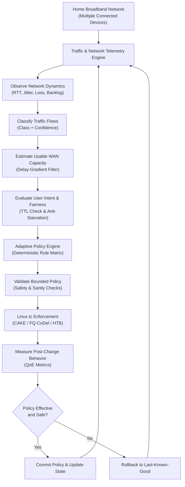
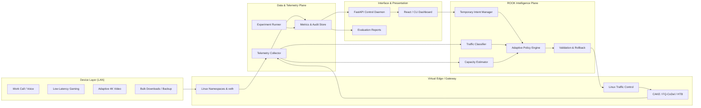

<div align="center">

# ROOK

**An intent-aware, feedback-driven Adaptive Quality of Service (QoS) engine for mixed home broadband traffic.**

[](https://github.com/ynsh-ai/ROOK)
[](https://github.com/ynsh-ai)
[](https://www.tataelxsi.com)
[](#2-problem-statement)
[](https://man7.org/linux/man-pages/man8/tc.8.html)
[](#10-privacy-safety-and-reliability)
[](docs/requirements-traceability.md)
[](LICENSE)

<br/>

**Built by Team LATENTS** · Tata Elxsi TELIPORT Season 4 · Track 03 · Case Study 03

[Explore Architecture](#6-system-architecture) • [Core Control Loop](#5-core-design-closed-loop-control) • [Interactive Scenarios](#8-key-demonstration-scenarios) • [Requirements Matrix](docs/requirements-traceability.md) • [Roadmap](#15-implementation-roadmap)

</div>

---

> [!NOTE]
> **Project Status Integrity:** This README describes the proposed system design, target architecture, and verification baseline for Tata Elxsi TELIPORT Season 4. Individual components, integrations, and performance results must be marked as implemented only after they are present in the repository and verified through reproducible tests. For a granular requirements-to-evidence mapping, consult our [Requirements Traceability Matrix](docs/requirements-traceability.md).

---

## 📑 Interactive Table of Contents

<details open>
<summary><b>Click to expand / collapse navigation</b></summary>

- [1. Overview](#1-overview)
- [2. Problem Statement](#2-problem-statement)
- [3. Project Objectives](#3-project-objectives)
- [4. ROOK Compared with Existing QoS Approaches](#4-rook-compared-with-existing-qos-approaches)
- [5. Core Design: Closed-Loop Control](#5-core-design-closed-loop-control)
  - [5.1 Observe](#51-observe)
  - [5.2 Classify](#52-classify)
  - [5.3 Estimate Usable WAN Capacity](#53-estimate-usable-wan-capacity)
  - [5.4 Evaluate User Intent and Fairness](#54-evaluate-user-intent-and-fairness)
  - [5.5 Decide: Adaptive Policy Engine](#55-decide-adaptive-policy-engine)
  - [5.6 Enforce and Verify](#56-enforce-and-verify)
- [6. System Architecture](#6-system-architecture)
- [7. Proposed Modules and Contracts](#7-proposed-modules-and-contracts)
- [8. Key Demonstration Scenarios](#8-key-demonstration-scenarios)
  - [Scenario 1: Large ISO Download During Video Conference](#scenario-1--large-iso-download-during-a-video-conference)
  - [Scenario 2: WAN Capacity Drops from 100 Mbps to 20 Mbps](#scenario-2--wan-capacity-drops-from-100-mbps-to-20-mbps)
  - [Scenario 3: Three TVs Streaming While a User Is Gaming](#scenario-3--three-tvs-streaming-while-a-user-is-gaming)
- [9. Evaluation Methodology](#9-evaluation-methodology)
- [10. Privacy, Safety and Reliability](#10-privacy-safety-and-reliability)
- [11. Target Technology Stack](#11-target-technology-stack)
- [12. Dashboard and User Experience](#12-dashboard-and-user-experience)
- [13. Reproducible Experiment Design](#13-reproducible-experiment-design)
- [14. Repository Structure](#14-repository-structure)
- [15. Implementation Roadmap](#15-implementation-roadmap)
- [16. Limitations and Scope](#16-limitations-and-scope)
- [17. Success Criteria](#17-success-criteria)
- [18. Team](#18-team)
- [19. References and Further Reading](#19-references-and-further-reading)

</details>

---

## 1. Overview

**ROOK** is an adaptive Quality of Service (QoS) controller designed for residential broadband networks where multiple devices and applications compete for constrained bandwidth.

A typical household concurrently runs:
- Video conferencing and voice calls (Zoom, Teams, Google Meet, WebRTC)
- Online and cloud gaming (low-latency UDP telemetry)
- Adaptive-bitrate video streaming (4K YouTube, Netflix, Prime Video)
- Large downloads and operating system updates (Steam, Windows/macOS updates, ISOs)
- Cloud backups and background file synchronization
- General web browsing, IoT telemetry, and social feeds

When these activities share a constrained broadband connection, high-throughput traffic can fill buffers at the bottleneck link. The result is bufferbloat: increased latency, severe jitter, packet loss, and degraded experiences for real-time applications—even when nominal line speed seems adequate.

Traditional fixed-policy QoS relies on static priority rules, fixed bandwidth ceilings, or legacy port classifications. While useful, static policies cannot adapt to fluctuating last-mile link capacity, shifting application mixes, or immediate user needs.

**ROOK coordinates these signals into an autonomous closed loop**: it observes link dynamics, classifies traffic non-invasively using metadata, tracks usable bottleneck capacity, evaluates temporary user intent, enforces bounded queue policies via Linux Traffic Control (`tc`), and continuously verifies post-enforcement QoE outcomes.

---

## 2. Problem Statement

Home broadband is a shared, variable-capacity resource where conflicting applications demand different performance characteristics:

| Traffic Type | Typical Requirement | What Goes Wrong Under Congestion |
| :--- | :--- | :--- |
| **Video Conferencing / Voice** | Low latency ($<30\text{ ms}$), minimal jitter, near-zero loss | Audio dropouts, frozen video frames, robotic voice artifacts |
| **Interactive Gaming** | Ultra-low, stable latency ($<20\text{ ms}$), zero jitter | De-sync, delayed player action response, dropped server ticks |
| **Adaptive Video Streaming** | High sustained throughput, predictable buffer pacing | Sudden quality downgrades (4K $\rightarrow$ 480p), rebuffering stalls |
| **Downloads / Updates / Backups** | High throughput; delay-tolerant | Inundates FIFO buffers, creating massive bufferbloat for all devices |
| **Other / Unknown** | Varies by application | Risks being misclassified or starved by rigid static filters |

The challenge is not simply to maximize throughput or assign blanket priority to one flow. The controller must balance seven essential properties:

```
┌────────────────────────────────────────────────────────────────────────┐
│                        ROOK Balancing Pillars                          │
├────────────────────────────────────────────────────────────────────────┤
│ 1. Responsiveness ── Protect interactive delay under saturation        │
│ 2. Capacity       ── Dynamically track volatile WAN link capacity      │
│ 3. Intent         ── Respect time-bounded user prioritization requests │
│ 4. Fairness       ── Prevent starvation of low-priority bulk transfers │
│ 5. Stability      ── Avoid high-frequency policy oscillation           │
│ 6. Safety         ── Guarantee safe rollbacks to known-good states     │
│ 7. Privacy        ── Zero DPI; strictly non-payload metadata analysis  │
└────────────────────────────────────────────────────────────────────────┘
```

---

## 3. Project Objectives

- **Classify Broad Household Traffic**: Extract statistical flow features without decrypting application payloads.
- **Estimate Usable WAN Capacity**: Detect sustained bottleneck shifts (such as a 100 Mbps $\rightarrow$ 20 Mbps drop) within seconds.
- **Support Temporary User Intent**: Provide an API/UI for scoped priority boosts (e.g., *"prioritize my work call for 30 minutes"*) with automatic TTL expiry.
- **Make Bounded Decisions**: Calculate policy adjustments incorporating flow confidence, link capacity, congestion, and mathematical fairness.
- **Open Linux Enforcement**: Manage queues through open, inspectable primitives: CAKE, FQ-CoDel, and HTB.
- **Closed-Loop Verification**: Measure real-time network response and roll back to the last-known-good state if verification fails.
- **Transparent Telemetry**: Expose health, active policies, and live queue backlogs via API and dashboard.
- **Reproducible Comparisons**: Benchmark **No QoS**, **Static QoS**, and **Adaptive ROOK** under identical testbed conditions.

---

## 4. ROOK Compared with Existing QoS Approaches

ROOK does not claim to invent adaptive QoS or queue management. Its unique contribution is the **coordination of non-payload classification, dynamic capacity tracking, user intent arbitration, and closed-loop verification in a single residential controller**:

| Capability | Fixed-Policy Router QoS | Standalone SQM (CAKE / FQ-CoDel) | Commercial DPI Appliances | **ROOK (Team LATENTS)** |
| :--- | :--- | :--- | :--- | :--- |
| **Traffic Intelligence** | Static ports / IP rules | Flow-blind hashing | Deep Packet Inspection (DPI) | **Zero-DPI Statistical Metadata** |
| **Capacity Awareness** | Manual fixed limit | Manual shaper configuration | Vendor-dependent | **Autonomous Delay-Gradient Tracking** |
| **Temporary User Intent** | None or manual router tweak | None | Complex firewall policies | **TTL-Bounded REST/CLI Intent API** |
| **Starvation Prevention** | Weak (strict priority starves) | Implicit per-flow fairness | Vendor heuristics | **Mathematical Minimum Floor ($10\%$)** |
| **Inspectable Linux `tc`** | Often proprietary / legacy | Fully open | Proprietary kernel modules | **Open, Inspectable Linux `tc` Stack** |
| **Closed-Loop Verification** | None | Real-time queue metrics | Varies | **Continuous Verification & Safe Rollback** |
| **Privacy Compliance** | Partial | Complete (No inspection) | Low (Inspects payloads) | **Strictly Metadata; Zero Decryption** |

---

## 5. Core Design: Closed-Loop Control

ROOK executes an autonomous, continuous control cycle:

$$\mathbf{OBSERVE} \longrightarrow \mathbf{CLASSIFY} \longrightarrow \mathbf{ESTIMATE} \longrightarrow \mathbf{DECIDE} \longrightarrow \mathbf{ENFORCE} \longrightarrow \mathbf{VERIFY} \longrightarrow \mathbf{FEEDBACK}$$



<details>
<summary><b>🔍 Click to expand Core Module Deep Dives (5.1 – 5.6)</b></summary>

### 5.1 Observe
Collects telemetry from network interfaces and queue disciplines:
- Round-trip time (RTT) and one-way delay variation
- RFC 3550 packet jitter
- Packet drop rates and Explicit Congestion Notification (ECN) marking
- Delivered throughput per traffic class
- Queue backlog and buffer depth from `tc -s qdisc`

### 5.2 Classify
Categorizes flows into broad behavioral profiles without reading application payloads:
- **Feature Set**: Inter-arrival times (IAT), packet length quantiles, directional byte ratios, burst durations, and transport signaling (TCP flags/windows).
- **Confidence Scoring**: Each flow outputs class $C_i$ and confidence $p \in [0.0, 1.0]$.
- **Safe Fallback**: Flows with confidence below $0.70$ are assigned to Best-Effort with fair queuing to eliminate misclassification penalties.

### 5.3 Estimate Usable WAN Capacity
Tracks changing bottleneck capacity using passive delay gradients ($\frac{dRTT}{dt}$):
- Differentiates transient burst dips from true, sustained capacity changes (e.g., $100\text{ Mbps} \rightarrow 20\text{ Mbps}$).
- Feeds an estimated rate $C_{\text{est}}$ to the policy engine to adjust shaper ceilings before modem buffers inflate.

### 5.4 Evaluate User Intent and Fairness
Enables temporary user requests:
- Example: *"Prioritize workstation video call for 30 minutes."*
- Bounded by strict Time-To-Live (TTL); automatically expires.
- Clamped by fairness constraints: an intent cannot consume more than $C_{\text{est}} - \sum B_{\min}$, preventing starvation of other household users.

### 5.5 Decide: Adaptive Policy Engine
Employs an inspectable, deterministic rule-based matrix:
- Adjusts Hierarchical Token Bucket (HTB) rates and ceilings.
- Applies hysteresis and minimum hold times ($>2\text{ s}$) to prevent high-frequency policy oscillation.
- Generates transparent, auditable decision records with reason codes.

### 5.6 Enforce and Verify
Executes kernel-level changes through Linux Traffic Control:
- Configures HTB parent classes with leaf CAKE or FQ-CoDel disciplines.
- Verifies installed state using `tc -s qdisc show`.
- Implements an automated rollback handler if enforcement fails or packet loss surges unexpectedly.

</details>

---

## 6. System Architecture

The modular architecture isolates kernel data-plane scheduling from user-space control intelligence and telemetry interfaces:



### Layer Responsibilities

| Layer | Responsibility | Components |
| :--- | :--- | :--- |
| **Device Layer** | Generates heterogeneous household traffic profiles | WebRTC calls, UDP gaming, HLS/DASH video, TCP bulk transfers |
| **Virtual Edge / Router** | Provides controllable bottleneck and packet scheduling | Linux namespaces, `veth` virtual pairs, routing, Linux `tc` |
| **QoS Intelligence** | Interprets traffic dynamics and orchestrates policy | Classifier, capacity estimator, intent manager, policy engine |
| **Enforcement** | Open kernel queueing, rate limiting, and AQM | HTB hierarchical shaper, CAKE, FQ-CoDel leaf qdiscs |
| **Data & Telemetry** | Collects performance evidence and generates reports | Metrics sampler, scenario runner, audit record store |
| **User Interface** | Exposes system state, intent controls, and metrics | FastAPI REST endpoints, CLI live monitor, web interface |

---

## 7. Proposed Modules and Contracts

Every module in ROOK is designed with explicit inputs, outputs, state lifecycles, and failure-handling contracts:

| Module | Inputs | Outputs | State Transitions | Failure / Fallback Expectation |
| :--- | :--- | :--- | :--- | :--- |
| **Traffic Classification Engine** | Flow metadata, timing, packet sizes | Class ID, confidence ($p$), feature summary | `New` $\rightarrow$ `Classified` $\rightarrow$ `Uncertain` $\rightarrow$ `Expired` | Safe fallback to Best-Effort for low confidence; zero payload decryption |
| **Link Capacity Estimator** | Throughput samples, RTT gradients | Usable capacity estimate ($C_{\text{est}}$), confidence | `Init` $\rightarrow$ `Estimating` $\rightarrow$ `Stable` $\rightarrow$ `Step-Down` | Retains last valid estimate; ignores single-packet noise dips |
| **Service Intent Manager** | REST/CLI intent request, duration | Validated intent, status, expiry timestamp | `Requested` $\rightarrow$ `Active` $\rightarrow$ `Constrained` $\rightarrow$ `Expired` | Rejects invalid parameters; automatically expires on TTL termination |
| **Adaptive Policy Engine** | Classes, capacity, telemetry, intent | Validated policy spec, decision reason | `Evaluating` $\rightarrow$ `Proposed` $\rightarrow$ `Committed` $\rightarrow$ `Hold` | Reverts to last-known-good configuration if inputs are invalid |
| **Enforcement & Verification** | Policy specification, interface state | Applied state, verification status | `Ready` $\rightarrow$ `Applying` $\rightarrow$ `Verified` $\rightarrow$ `Rollback` | Automatically rolls back to safe state on verification mismatch |
| **Dashboard & API** | Metric streams, audit logs, intents | Live UI views, JSON telemetry, reports | `Collecting` $\rightarrow$ `Healthy` $\rightarrow$ `Stale` $\rightarrow$ `Recovering` | Clearly labels simulated vs. measured data; prevents arbitrary shell execution |

---

## 8. Key Demonstration Scenarios

ROOK is evaluated against the three official challenge scenarios defined in Track 03:

### Scenario 1 — Large ISO Download During a Video Conference
*A 10 GB file download saturates the link while an interactive WebRTC video conference is active.*

<details open>
<summary><b>Click to expand Scenario 1 Setup & Verification Plan</b></summary>

- **Setup**: Start a continuous video-conference flow (small, uniform UDP cadence). Introduce a saturated multi-stream TCP ISO download.
- **Expected Controller Action**:
  - Classify the video call as interactive ($C_1$) and the download as bulk ($C_5$).
  - Allocate the bulk transfer to a dedicated class governed by CAKE with a guaranteed bandwidth floor ($10\%$).
  - Prioritize video conferencing packets to bypass queue backlog.
- **Measurements**: Loaded RTT (p50/p99), jitter (RFC 3550), packet drop rate, and bulk throughput continuity.
- **Success Criteria**: Video call latency stays below $25\text{ ms}$ with zero packet loss, while the bulk transfer maintains sustained, non-starved progress.

</details>

---

### Scenario 2 — WAN Capacity Drops from 100 Mbps to 20 Mbps
*The upstream WAN bottleneck rate suffers a sudden, sustained reduction from 100 Mbps to 20 Mbps.*

<details>
<summary><b>Click to expand Scenario 2 Setup & Verification Plan</b></summary>

- **Setup**: Establish a 100 Mbps WAN bottleneck with mixed active flows. Trigger a step-down to 20 Mbps via upstream netem shaper.
- **Expected Controller Action**:
  - Detect delay-gradient inflection ($\frac{dRTT}{dt} > 0$) and throughput throttling within 1.5 seconds.
  - Dynamically recalculate root HTB shaper ceiling to $19\text{ Mbps}$ ($95\%$ of estimated capacity).
  - Prevent bufferbloat buildup inside opaque ISP modem buffers.
- **Measurements**: Detection time, estimation error, queue backlog, loaded latency before/after adaptation, and policy stability (avoiding oscillation).
- **Success Criteria**: Controller converges within $<2.0\text{ seconds}$, stabilizing latency without chronic policy flipping.

</details>

---

### Scenario 3 — Three TVs Streaming While a User Is Gaming
*Three Smart TVs request 4K adaptive video (bursty chunk fetches) while a gaming console transmits latency-critical packets.*

<details>
<summary><b>Click to expand Scenario 3 Setup & Verification Plan</b></summary>

- **Setup**: Generate three concurrent HLS/DASH video chunk-stream profiles alongside a low-latency UDP gaming flow.
- **Expected Controller Action**:
  - Separate video chunk traffic from gaming packets using flow metadata.
  - Forward gaming packets in Class $C_2$ with minimal queueing delay.
  - Apply deficit fair queueing across the three video streams in Class $C_3$.
- **Measurements**: Game tick latency and jitter, streaming throughput per TV, rebuffering events, and Jain's Fairness Index.
- **Success Criteria**: Gaming latency remains $\le 18\text{ ms}$ with jitter $\le 5\text{ ms}$; all three TVs maintain buffer health without underruns.

</details>

---

## 9. Evaluation Methodology

ROOK is systematically benchmarked across three operational modes under identical network conditions:
1. **No QoS**: Unmanaged baseline with standard FIFO queueing.
2. **Static QoS**: Fixed priority queues and static rate shaping without dynamic capacity tracking.
3. **Adaptive ROOK**: Autonomous closed-loop controller with dynamic capacity estimation and intent awareness.

### Evaluation Metrics

| Metric | Measurement Scope | Relevance & Target |
| :--- | :--- | :--- |
| **Loaded Latency (p99)** | RTT under full saturation load | Measures bufferbloat elimination ($\le 25\text{ ms}$ target) |
| **Jitter (RFC 3550)** | Packet delay variation on interactive flows | Critical for voice and game responsiveness ($\le 5\text{ ms}$ target) |
| **Packet Loss Rate** | Lost vs. transmitted packets per class | Reliability assurance ($0.0\%$ target on interactive classes) |
| **Throughput & Progress** | Delivered bandwidth per class | Ensures anti-starvation for background bulk flows |
| **Queue Backlog** | Buffer depth at the bottleneck | Direct measure of queue buildup prevention |
| **Classification Accuracy** | Accuracy against labelled test flows | Quality of metadata-based behavioral classification |
| **Capacity Estimation Error** | $|C_{\text{est}} - C_{\text{true}}| / C_{\text{true}}$ | Accuracy of dynamic link estimation |
| **Adaptation Time** | Time from WAN change to stable policy | Speed of response to network degradation ($<2.0\text{ s}$) |
| **Policy Stability** | Frequency and magnitude of shaper adjustments | Verifies absence of harmful policy oscillation |
| **System Overhead** | CPU and memory footprint | Edge feasibility ($\le 3.0\%$ CPU on gateway target) |
| **Fairness Index** | Service distribution across active flows | Prevents flow monopolization ($J \ge 0.90$) |

### Jain's Fairness Index Formulation

For non-negative throughput values $(x_1, x_2, \dots, x_n)$:

$$J(x_1, \dots, x_n) = \frac{\left(\sum_{i=1}^{n}x_i\right)^2}{n \sum_{i=1}^{n}x_i^2}$$

*The index ranges from $1/n$ (worst-case single-flow dominance) to $1.0$ (perfect mathematical equality). ROOK interprets fairness alongside application SLAs: latency-sensitive flows require delay protection, while bulk flows require guaranteed bandwidth progress.*

---

## 10. Privacy, Safety and Reliability

```
┌────────────────────────────────────────────────────────────────────────┐
│                   ROOK Privacy & Safety Guardrails                     │
├────────────────────────────────────────────────────────────────────────┤
│ 🛡️ Zero-DPI Privacy    ── Strictly header metadata; no decryption      │
│ 🛡️ Safe Fallbacks      ── Low-confidence flows default to Best-Effort  │
│ 🛡️ Anti-Starvation     ── Minimum 10% bandwidth floor for bulk queues   │
│ 🛡️ Bounded Control     ── Rate changes clamped within safe margins      │
│ 🛡️ Automatic Expiry    ── Intents expire deterministically on TTL end  │
│ 🛡️ Atomic Rollback     ── Automatic restoration of last-known-good     │
│ 🛡️ No Shell Injection  ── Constrained controller operations only        │
│ 🛡️ Credential Hygiene  ── Zero embedded secrets; RFC-compliant test IPs │
└────────────────────────────────────────────────────────────────────────┘
```

---

## 11. Target Technology Stack

| Area | Component | Implementation Role |
| :--- | :--- | :--- |
| **Platform** | Linux Kernel $\ge 5.4$ (Ubuntu / Debian / OpenWrt) | Core operating system supporting modern queueing schedulers |
| **Emulation** | Linux Network Namespaces (`ip netns`), `veth` | Hermetic, reproducible multi-node residential testbed |
| **Traffic Control** | `iproute2` / Linux `tc` | Open, in-kernel queue management and packet shaping |
| **Queue Management** | CAKE, FQ-CoDel | Active Queue Management (AQM) and flow-isolation scheduling |
| **Rate Shaping** | HTB (Hierarchical Token Bucket) | Class-based bandwidth reservation and ceiling control |
| **Ingress Redirection** | IFB (Intermediate Functional Block) | Ingress shaping experiments where required |
| **Control Intelligence**| Python 3.10+ | Classification, capacity estimation, and policy engine |
| **Management API** | FastAPI / Uvicorn | High-performance REST interface for intents and telemetry |
| **Dashboard UI** | React, TypeScript, Tailwind CSS, Python Rich | Real-time monitoring and intent management |
| **Visualizations** | Recharts, Matplotlib | Telemetry series and comparative benchmark visualizer |
| **Traffic Generation** | `iperf3`, `ping`, custom UDP generators | Repeatable, labelled workload generation |

---

## 12. Dashboard and User Experience

<details open>
<summary><b>Click to expand Dashboard Capabilities & Mock Telemetry View</b></summary>

```
┌────────────────────────── ROOK Autonomous Edge Sentinel ──────────────────────────┐
│ Gateway IP: 192.168.1.1  │ WAN Bottleneck: 100 Mbps (Est: 98.4 Mbps)             │
│ Active Intent: Work Call Priority (192.168.1.150) ── Expires in: 18m 42s          │
├────────────────────────────┬─────────────┬─────────────┬────────────┬─────────────┤
│ Traffic Class              │ Bandwidth   │ Delay (p99) │ Loss Rate  │ Health      │
├────────────────────────────┼─────────────┼─────────────┼────────────┼─────────────┤
│ 🔵 C1: Voice / Conference  │ 1.8 Mbps    │ 16.2 ms     │ 0.0%       │ OPTIMAL     │
│ 🟢 C2: Interactive Gaming  │ 2.4 Mbps    │ 14.5 ms     │ 0.0%       │ OPTIMAL     │
│ 🟡 C3: 4K Video Streaming  │ 24.1 Mbps   │ 21.0 ms     │ 0.0%       │ OPTIMAL     │
│ ⚪ C4: Best-Effort Web     │ 7.2 Mbps    │ 23.8 ms     │ 0.0%       │ NORMAL      │
│ 🟣 C5: Bulk Transfers      │ 62.9 Mbps   │ 27.4 ms     │ 0.0%       │ SUSTAINED   │
├────────────────────────────┴─────────────┴─────────────┴────────────┴─────────────┤
│ Jain's Fairness Index: 0.94 │ Shaper Status: HTB+CAKE Engaged │ Rollback State: READY │
└───────────────────────────────────────────────────────────────────────────────────┘
```

### Key UI Features:
- **Network Overview**: Live gauges for latency, jitter, loss, queue backlogs, and dynamic capacity tracking.
- **Traffic Analysis**: Real-time breakdown of flows, assigned categories, and confidence scores.
- **Intent Manager**: One-click temporary priority requests with visual TTL timers and fairness indicators.
- **Audit History**: Inspectable log of all policy changes, reasons, and verification outcomes.
- **Experiment Studio**: Comparison view plotting No QoS vs. Static QoS vs. Adaptive ROOK.

</details>

---

## 13. Reproducible Experiment Design

The evaluation harness allows researchers and evaluators to execute full scenario runs with a single command:

```
[1. Check Environment] ──► [2. Reset Namespaces] ──► [3. Configure Impairment]
                                                              │
                                                              ▼
[6. Generate Report]   ◄── [5. Measure & Audit]   ◄── [4. Inject Scenario Load]
```

### Reproducibility Commands:
```bash
# 1. Reset testbed namespaces and virtual ethernet links
sudo bash scripts/setup_testbed.sh --reset

# 2. Run Scenario 1: Bulk ISO during active video conference
sudo python3 tests/run_benchmarks.py --scenario iso_videocall --mode all --output results/

# 3. Run Scenario 2: WAN capacity drop (100 Mbps -> 20 Mbps)
sudo python3 tests/run_benchmarks.py --scenario wan_stepdown --mode all --output results/

# 4. Generate comparison report
python3 scripts/generate_report.py --input results/
```

---

## 14. Repository Structure

```
ROOK/
├── LICENSE                          # MIT License
├── requirements.txt                 # Core runtime dependencies
├── README.md                        # Interactive project documentation
├── docs/
│   ├── requirements-traceability.md # Official Case Study 03 requirements mapping
│   ├── architecture.md              # Detailed subsystem architectural design
│   ├── experiment-methodology.md    # Benchmark procedures and measurement protocols
│   └── safety-and-privacy.md        # Security boundaries and rollback specifications
├── controller/
│   ├── classifier/                  # Non-payload statistical flow categorizer
│   ├── capacity/                    # Delay-gradient link capacity estimator
│   ├── intent/                      # Scoped user intent manager and fairness clamps
│   ├── policy/                      # Deterministic rate governor and rule matrix
│   └── verification/                # Closed-loop QoE verification engine
├── enforcement/
│   ├── tc/                          # Linux traffic control netlink wrapper
│   └── rollback/                    # Last-known-good configuration restorer
├── telemetry/                       # Metric collection and live stats samplers
├── experiments/
│   ├── scenarios/                   # Automated implementations of Scenarios 1, 2, and 3
│   ├── traffic/                     # Labelled traffic workload profiles
│   └── reports/                     # Generated benchmark comparisons and plots
├── api/                             # FastAPI control and telemetry server
├── dashboard/                       # Terminal and web user interface
└── tests/
    ├── unit/                        # Isolated unit tests for all modules
    ├── integration/                 # End-to-end controller loop integration tests
    └── scenarios/                   # Automated experiment verification tests
```

---

## 15. Implementation Roadmap

Track progress across the 10 planned development phases:

- [x] **Phase 1: Testbed Foundation** — Ubuntu environment, Linux namespaces (`ns_client`, `ns_router`, `ns_wan`), `veth` topology, and routing.
- [x] **Phase 2: Formal Specifications** — Problem modeling, QoS class hierarchy, and official [Requirements Traceability Matrix](docs/requirements-traceability.md).
- [ ] **Phase 3: Traffic Classification Engine** — Statistical metadata feature extraction, rule matrix, and confidence scoring.
- [ ] **Phase 4: Dynamic Capacity Estimator** — Passive delay-gradient tracking filter; verification on 100 Mbps $\rightarrow$ 20 Mbps step-down.
- [ ] **Phase 5: Service Intent Manager** — REST/CLI interface for scoped user priority requests with TTL expiry and fairness clamps.
- [ ] **Phase 6: Deterministic Policy Engine** — Multi-tier rate calculator, anti-starvation guarantees, and oscillation damping.
- [ ] **Phase 7: Enforcement & Rollback** — Linux `tc` HTB + CAKE orchestration, verification loop, and automatic fault-recovery handler.
- [ ] **Phase 8: API & Dashboard** — FastAPI daemon, real-time terminal UI, and web telemetry interface.
- [ ] **Phase 9: Empirical Benchmark Suite** — Automated test harness executing Scenarios 1, 2, and 3 across No QoS, Static QoS, and Adaptive ROOK.
- [ ] **Phase 10: Documentation & Hardening** — Clean-environment reproduction audit, license inventory, and competition submission.

---

## 16. Limitations and Scope

ROOK is a reference implementation designed for controlled Linux environments. Realistic boundaries include:
- **Encrypted Metadata Limits**: Statistical analysis categorizes flow types, but cannot identify specific internal application activities within multiplexed connections.
- **Software Emulation vs. Switch Silicon**: Testing uses virtual Ethernet (`veth`) and `netem`. Line-rate multi-gigabit routing requires hardware offloading (XDP / eBPF / ASIC acceleration).
- **Wi-Fi Contention**: 802.11 wireless medium contention (EDCA/WMM) operates independently of wired queueing; cross-layer integration is reserved for future work.
- **Production ISP Integration**: Carrier deployment requires TR-181/USP data models and OpenSync/RDK-B integration.

---

## 17. Success Criteria

ROOK's success is evaluated on demonstrable evidence across 9 core criteria:
1. **Accurate Classification**: Identifies broad categories with reported confidence and safe handling of uncertainty.
2. **Reliable Estimation**: Tracks changing bottleneck capacity within documented error margins.
3. **Intent Lifecycle**: Accepts, validates, and automatically expires user intents.
4. **Explainable Decisions**: Produces deterministic, auditable policy updates.
5. **Inspectable Enforcement**: Applies and queries standard Linux kernel traffic control structures.
6. **Robust Rollback**: Restores safe network state upon validation or enforcement failure.
7. **Empirical QoE Improvement**: Measurably improves interactive latency, jitter, and loss over baselines without starving bulk flows.
8. **Reproducibility**: Executes Scenarios 1, 2, and 3 through automated scripts generating traceable evidence.
9. **Low Overhead**: Operates within modest CPU and memory constraints suitable for residential gateways.

---

## 18. Team

### Team LATENTS
**Competition**: Tata Elxsi TELIPORT Season 4 · Track 03  
**Case Study 03**: *Adaptive QoS Engine for Mixed Home Broadband Traffic*

- **Yanshi Chauhan** ([@ynsh-ai](https://github.com/ynsh-ai)) — Project Lead & Systems Architecture
- **Ayush Kumar Sharma** — Network Systems & Telemetry Engineering

---

## 19. References and Further Reading

- [Linux Traffic Control (`tc`) Manual](https://man7.org/linux/man-pages/man8/tc.8.html)
- [CAKE Queue Discipline (`tc-cake`)](https://man7.org/linux/man-pages/man8/tc-cake.8.html)
- [FQ-CoDel Queue Discipline (`tc-fq_codel`)](https://man7.org/linux/man-pages/man8/tc-fq_codel.8.html)
- [Hierarchical Token Bucket (`tc-htb`)](https://man7.org/linux/man-pages/man8/tc-htb.8.html)
- [OpenWrt Smart Queue Management (SQM)](https://openwrt.org/docs/guide-user/network/traffic-shaping/sqm)
- [RFC 8290: The FQ-CoDel Packet Scheduler](https://datatracker.ietf.org/doc/html/rfc8290)
- [RFC 8289: Controlled Delay (CoDel) Active Queue Management](https://datatracker.ietf.org/doc/html/rfc8289)
- [RFC 3550: RTP / Jitter Calculation Specifications](https://datatracker.ietf.org/doc/html/rfc3550)
- [FastAPI Documentation](https://fastapi.tiangolo.com/)

---

<div align="center">

**ROOK — Your Network's Silent Guardian**  
*Built with precision by Team LATENTS*

</div>
