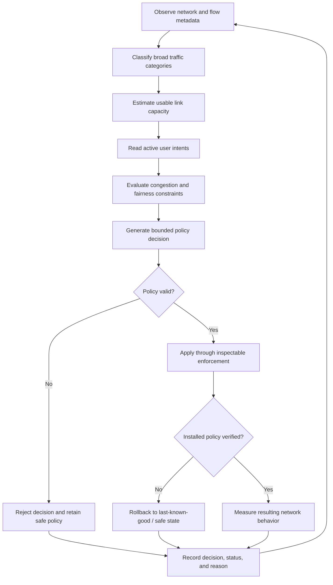

# ROOK — Requirements Traceability

**Project:** ROOK — Adaptive QoS Engine for Mixed Home Broadband Traffic  
**Team:** LATENTS  
**Competition:** Tata Elxsi TELIPORT Season 4  
**Track:** 03  
**Source of requirements:** Official Case Study 03 problem statement supplied by the team  
**Document purpose:** Map each challenge requirement to the ROOK architecture, implementation work, and evidence required for verification.

> **Status integrity:** This document is a planning and verification baseline. The project repository has not been inspected as part of creating this document, so no feature is asserted to be implemented. Unless the team has independently verified implementation, treat the status values below as **Planned** or **To verify**. Update them only when code, tests, configuration, or experiment evidence supports the change.

---

## 1. Status Definitions

| Status | Meaning |
| :--- | :--- |
| **Implemented** | Working code exists and the stated acceptance evidence has been produced. |
| **Partial** | Some of the requirement is implemented, but one or more acceptance conditions remain incomplete. |
| **Planned** | The requirement is part of the design or roadmap but is not yet verified as implemented. |
| **To verify** | The repository or experiment evidence must be inspected before assigning an implementation status. |
| **Not applicable** | The team has documented why the requirement does not apply to the prototype. |

*Do not mark a requirement **Implemented** based only on a design diagram, README description, mock dashboard, or planned command.*

---

## 2. System-Level Requirement Traceability

| ID | Official Requirement / Expected Outcome | ROOK Module or Workstream | Planned Implementation Approach | Acceptance Evidence | Initial Status |
| :--- | :--- | :--- | :--- | :--- | :--- |
| **SYS-01** | Create an intent-aware QoS controller for mixed home broadband traffic. | Controller, Intent Manager, Policy Engine | Integrate observation, classification, capacity estimation, intent handling, policy selection, enforcement, and verification into a closed-loop controller. | End-to-end demonstration showing a changing network condition leads to a policy decision, enforcement, and measured feedback. | Planned |
| **SYS-02** | Protect interactive applications while bulk traffic continues to make reasonable progress. | Policy Engine, Enforcement, Telemetry | Apply queue management and shaping that reduce interactive delay while preserving a measurable service floor or useful progress for bulk flows. | Concurrent interactive and bulk traffic experiment; report latency, jitter, loss, and per-class throughput. | Planned |
| **SYS-03** | Use independently testable modules. | All modules, Tests | Define module contracts, isolated tests, integration tests, and explicit state transitions. | Test plan and automated test results for each module and integrated workflow. | Planned |
| **SYS-04** | Define inputs, outputs, state transitions, failure handling, and success conditions for each module. | All modules, Documentation | Maintain module contracts in this document and module-specific design documentation. | Completed module-contract sections and tests covering success and failure paths. | Planned |
| **SYS-05** | Document the boundary between prototype and production-scale solution. | Architecture, Limitations, Deployment Documentation | Explain virtualization, hardware, security, performance, certification, scale, and operational constraints. | A documented prototype-versus-production section supported by deployment assumptions and limitations. | Planned |

---

## 3. Functional Requirement Traceability

### 3.1 Traffic Classification

| ID | Requirement | ROOK Module | Inputs | Expected Outputs | Acceptance Evidence | Initial Status |
| :--- | :--- | :--- | :--- | :--- | :--- | :--- |
| **CLS-01** | Classify broad traffic categories without reading private application payloads. | Traffic Classification Engine | Flow metadata and observable behavior, such as protocol metadata, packet sizes, timing, duration, counts, and rates. | Traffic class, flow identifier, confidence score, and classification timestamp. | Demonstrate classification using metadata-only observation; document that application payload decryption is not used. | Planned |
| **CLS-02** | Support relevant household traffic categories. | Traffic Classification Engine | Observed network flows. | Categories such as video conferencing, interactive gaming, voice, adaptive video/streaming, bulk downloads, software updates, cloud backup, and other/unknown. | Test dataset or generated traffic for each supported category, with class-level results. | Planned |
| **CLS-03** | Expose classifier confidence. | Traffic Classification Engine, API, Dashboard | Flow features and classifier output. | A numeric or otherwise explicitly defined confidence value associated with each classification. | API response and dashboard display include confidence; tests validate range and handling. | Planned |
| **CLS-04** | Allow correction of misclassification. | Classification Feedback API, Dashboard, Classifier | Flow identifier and user-selected corrected class. | Updated classification or an auditable correction record used by the relevant policy workflow. | Demonstration of a correction, persistence/audit behavior, and confirmation of how the corrected class affects policy. | Planned |
| **CLS-05** | Handle uncertain or unknown traffic safely. | Traffic Classification Engine, Policy Engine | Low-confidence or unsupported flow. | Unknown/uncertain classification that does not automatically receive an unjustified privileged treatment. | Tests for low-confidence flows and documented fallback behavior. | Planned |

> **Design note:** Classification is based on broad observable traffic behavior. The classifier must not decrypt application payloads. Classification accuracy should be reported against a documented test set or generated traffic labels; do not imply that metadata classification can identify every encrypted application with certainty.

---

### 3.2 Link-Capacity Estimation

| ID | Requirement | ROOK Module | Inputs | Expected Outputs | Acceptance Evidence | Initial Status |
| :--- | :--- | :--- | :--- | :--- | :--- | :--- |
| **CAP-01** | Estimate link capacity. | Link Capacity Estimator | Throughput observations, configured bottleneck information where available, and measurement history. | Estimated usable capacity, measurement window, confidence/quality indicator, and timestamp. | Compare estimates with controlled bottleneck settings across repeated test runs. | Planned |
| **CAP-02** | Detect a significant capacity change, including the illustrative 100 Mbps to 20 Mbps reduction. | Link Capacity Estimator | Time-series measurements during a controlled capacity change. | Updated capacity estimate and a change/detection event. | Reproducible experiment showing detection time and estimation error after the capacity change. | Planned |
| **CAP-03** | Avoid treating every temporary throughput reduction as a permanent capacity change. | Link Capacity Estimator | Noisy or short-lived throughput observations. | Smoothed or confidence-aware estimate with documented change criteria. | Tests using transient dips and sustained capacity changes; report false detections and response time. | Planned |
| **CAP-04** | Communicate estimator uncertainty to downstream policy logic. | Capacity Estimator, Policy Engine | Estimate and confidence/quality information. | Policy input that includes estimate validity or confidence. | Unit and integration tests showing how low-confidence estimates affect policy decisions. | Planned |

---

### 3.3 Temporary Service Intent

| ID | Requirement | ROOK Module | Inputs | Expected Outputs | Acceptance Evidence | Initial Status |
| :--- | :--- | :--- | :--- | :--- | :--- | :--- |
| **INT-01** | Support temporary user intent, such as prioritizing a work call. | Service Intent Manager, API/UI | Target device or traffic category, requested service, duration, and activation request. | Validated intent with identifier, status, activation time, and expiry time. | Create an intent through the API or UI and verify its state and effect on policy selection. | Planned |
| **INT-02** | Expire temporary intent. | Service Intent Manager | Active intent and expiry timestamp. | Expired/inactive intent that no longer influences policy selection. | Time-controlled test showing automatic expiry and policy recalculation. | Planned |
| **INT-03** | Validate and bound user intent. | Service Intent Manager, Policy Engine | User request and current system constraints. | Accepted, rejected, or adjusted intent with an explanation. | Tests for invalid duration, unsupported target, conflicting requests, and fairness constraints. | Planned |
| **INT-04** | Preserve fairness while honoring intent. | Policy Engine | Active intents, traffic state, capacity estimate, and fairness constraints. | Policy that gives requested traffic suitable treatment without starving other traffic. | Concurrent-flow experiment reporting interactive metrics and throughput/fairness for other flows. | Planned |

---

### 3.4 Adaptive Policy Selection

| ID | Requirement | ROOK Module | Inputs | Expected Outputs | Acceptance Evidence | Initial Status |
| :--- | :--- | :--- | :--- | :--- | :--- | :--- |
| **POL-01** | Apply queueing and shaping policies. | Adaptive Policy Engine | Traffic classes, capacity estimate, congestion metrics, active intents, current policy, and fairness constraints. | Validated policy parameters such as queue discipline, shaping rate, and class treatment. | Unit tests for policy decisions and an integration test confirming the selected policy reaches enforcement. | Planned |
| **POL-02** | Change policy as demand and link conditions change. | Adaptive Policy Engine | Updated telemetry, capacity estimate, traffic demand, and intents. | Policy update or explicit no-change decision with reason. | Controlled scenario demonstrating a policy response to changing load or capacity. | Planned |
| **POL-03** | Protect interactive latency, jitter, and packet loss. | Policy Engine, Enforcement, Telemetry | Interactive flow measurements and congestion state. | Policy intended to reduce delay and loss for interactive traffic. | Before/after measurements under equivalent load; report repeated-run results. | Planned |
| **POL-04** | Maintain reasonable progress for bulk traffic. | Policy Engine, Enforcement | Bulk-flow throughput and queue state. | Non-starving treatment for bulk flows. | Demonstrate continuing bulk throughput during an interactive-priority scenario. | Planned |
| **POL-05** | Prevent starvation of low-priority traffic. | Policy Engine, Enforcement | Per-class throughput and policy allocation. | Fairness constraints or minimum service behavior. | Long-enough concurrent-flow test with per-class throughput and Jain's Fairness Index, plus explicit starvation checks. | Planned |
| **POL-06** | Avoid unstable policy oscillation. | Policy Engine | Noisy telemetry and changing demand. | Bounded adjustments, hysteresis, minimum hold times, or other documented stability controls. | Time-series policy log showing behavior under fluctuating measurements; report policy changes and settling behavior. | Planned |
| **POL-07** | Make policy decisions explainable and auditable. | Policy Engine, Controller, Dashboard | Decision inputs and selected policy. | Decision record including reason, relevant measurements, active intent, and policy version. | Inspectable policy history and tests that verify decision records are generated. | Planned |

> **Baseline approach:** The initial policy engine is intended to be deterministic and rule-based. If AI or machine learning is later introduced, evaluate it against this deterministic baseline and report a measurable improvement. A conversational interface alone is not evidence of improved QoS.

---

### 3.5 Enforcement, Verification, and Recovery

| ID | Requirement | ROOK Module | Inputs | Expected Outputs | Acceptance Evidence | Initial Status |
| :--- | :--- | :--- | :--- | :--- | :--- | :--- |
| **ENF-01** | Use Linux traffic control or another open and inspectable enforcement mechanism. | Enforcement Engine | Validated policy object. | Applied Linux traffic-control configuration or documented equivalent. | Inspectable configuration and repeatable test showing the policy was applied. | Planned |
| **ENF-02** | Support suitable queueing and shaping mechanisms. | Enforcement Engine | Policy parameters and interface configuration. | Configuration using selected mechanisms such as CAKE, FQ-CoDel, HTB, and IFB where applicable. | Documented mechanism selection and verification output from the target environment. | Planned |
| **ENF-03** | Verify that the requested policy was actually installed. | Enforcement and Verification Engine | Desired policy and live system configuration. | Verification result: success, mismatch, or failure, with details. | Test that compares desired configuration with inspected installed configuration. | Planned |
| **ENF-04** | Provide policy rollback. | Enforcement and Verification Engine | Last-known-good configuration and failed/unsafe update. | Restored previous known-good policy or documented safe fallback. | Fault-injection test demonstrating rollback and confirming resulting system state. | Planned |
| **ENF-05** | Return to a known safe state after failure. | Controller, Enforcement Engine | Command failure, invalid policy, interface loss, or verification failure. | Bounded failure response, safe fallback, and observable error state. | Tests for failure cases and evidence that the system does not leave an unverified policy active. | Planned |
| **ENF-06** | Keep automated remediation bounded, observable, and reversible. | Policy Engine, Enforcement, Audit Logging | Proposed policy change and system constraints. | Validated change with audit record and rollback path. | Tests for parameter bounds, audit output, and rollback. | Planned |

> **Safety rule:** The dashboard or API must not pass arbitrary shell commands to the enforcement layer. The controller should translate validated policy parameters into a constrained set of supported operations.

---

### 3.6 Dashboard and User Interface

| ID | Requirement | ROOK Module | Inputs | Expected Outputs | Acceptance Evidence | Initial Status |
| :--- | :--- | :--- | :--- | :--- | :--- | :--- |
| **UI-01** | Provide a dashboard for latency, jitter, loss, throughput, queue depth, and fairness. | Monitoring Dashboard | Telemetry and experiment data. | Clearly labelled metric views and time series. | Dashboard screenshot plus verification that values originate from measurements or are explicitly labelled simulated. | Planned |
| **UI-02** | Provide an API or user interface for temporary service intent. | FastAPI Backend, Dashboard, Intent Manager | User intent request. | Intent creation, status, cancellation, and expiry information as supported. | API tests or end-to-end UI demonstration. | Planned |
| **UI-03** | Expose classification confidence and correction. | Dashboard, Classification API | Classifier output and user correction. | Confidence display and correction workflow. | Demonstration and API/UI tests. | Planned |
| **UI-04** | Show current policy and policy history. | Dashboard, Controller | Policy decisions and enforcement verification. | Current policy, previous decisions, timestamps, and status. | Compare dashboard history with controller logs. | Planned |
| **UI-05** | Distinguish simulated data from real measurements. | Dashboard, Telemetry | Measurement source and simulation metadata. | Visible source/type labels for each relevant dataset or view. | UI review and tests for source labels. | Planned |

---

## 4. Official Illustrative Scenario Traceability

The following scenarios are explicitly described in Case Study 03. They must be treated as reproducible experiments, not merely screenshots or informal demonstrations.

### EXP-01 — Large ISO Download During a Video Conference

| Item | Definition |
| :--- | :--- |
| **Condition** | A large ISO download starts while a video conference is active. |
| **Traffic** | Interactive video-conference-like flow plus a bulk file transfer. |
| **Expected Controller Behavior** | Identify broad traffic classes, observe congestion, apply a policy that protects call latency while allowing the download to continue. |
| **Measurements** | Loaded latency, jitter, packet loss, per-class throughput, queue depth/backlog, policy changes, and CPU overhead. |
| **Success Conditions** | Compared with the selected baseline, interactive performance improves or is maintained under the stated test conditions, while bulk traffic continues to make measurable progress and is not starved. |
| **Evidence to Retain** | Test configuration, traffic-generation parameters, time-series data, controller logs, enforcement verification, and generated comparison report. |
| **Initial Status** | Planned |

---

### EXP-02 — WAN Capacity Reduction from 100 Mbps to 20 Mbps

| Item | Definition |
| :--- | :--- |
| **Condition** | The configured WAN bottleneck changes from 100 Mbps to 20 Mbps. |
| **Traffic** | A documented mix of traffic classes running across the capacity change. |
| **Expected Controller Behavior** | Detect the sustained capacity reduction, update the usable-capacity estimate, and recalculate shaping rather than continuing with an outdated rate. |
| **Measurements** | Capacity-estimation error, detection/adaptation time, loaded latency, jitter, packet loss, throughput, queue depth, and policy stability. |
| **Success Conditions** | The controller adapts within a measured time, reduces harmful queue buildup relative to the relevant baseline, and avoids excessive policy oscillation. |
| **Evidence to Retain** | Exact impairment settings, time of capacity change, estimator output, policy history, telemetry, and report. |
| **Initial Status** | Planned |

---

### EXP-03 — Three Televisions Streaming While a Gaming Device Requires Low Latency

| Item | Definition |
| :--- | :--- |
| **Condition** | Three television-like streaming flows run concurrently with an interactive gaming-like flow. |
| **Traffic** | Three streaming flows plus one interactive flow, with traffic-generation settings documented. |
| **Expected Controller Behavior** | Balance service quality, protect interactive responsiveness, and preserve useful throughput for streaming flows. |
| **Measurements** | Interactive latency and jitter, packet loss, throughput per streaming flow, total throughput, queue depth, and fairness. |
| **Success Conditions** | Interactive performance meets the experiment's declared target while streaming flows continue to receive useful service without starvation. |
| **Evidence to Retain** | Flow parameters, experiment configuration, measurements, policy history, and comparison report. |
| **Initial Status** | Planned |

> **Scenario reporting rule:** Do not describe an expected outcome as an achieved result. Publish measured results only after running the experiment and retaining the configuration and raw evidence.

---

## 5. Reproducibility and Experiment Evidence

| ID | Requirement | ROOK Workstream | Acceptance Evidence | Initial Status |
| :--- | :--- | :--- | :--- | :--- |
| **REP-01** | Include generated data and network impairment settings needed to reproduce important results. | Experiments, Configurations | Versioned traffic parameters, impairment settings, seeds where relevant, and scenario configuration files. | Planned |
| **REP-02** | Provide a scripted demonstration that can reset the environment. | Experiment Runner, Network Setup | One documented command or script that resets the test topology to a known starting state. | Planned |
| **REP-03** | Introduce a selected test condition automatically or through a documented script. | Experiment Runner | Reproducible bandwidth, delay, loss, or traffic-load configuration. | Planned |
| **REP-04** | Collect evidence and generate a result report. | Telemetry, Experiment Runner, Reporting | Raw measurements, run metadata, logs, and generated summary report. | Planned |
| **REP-05** | Compare baseline and optimized experiments. | Benchmarking | Comparable runs for no QoS, static QoS, and adaptive ROOK policy, using documented conditions. | Planned |
| **REP-06** | Document exact setup prerequisites, versions, commands, configuration, and verification. | Setup Documentation | A clean-environment setup guide tested by another team member. | Planned |
| **REP-07** | Label emulated hardware/network capabilities and explain the model and limitations. | Network Testbed, Documentation | Explicit statement of what is emulated, how it is modeled, and what it does not represent. | Planned |

### Recommended Experiment Record
Every run should record at least:
- Experiment ID and scenario name.
- ROOK version or Git commit.
- Date/time and environment details.
- Operating system and relevant package/tool versions.
- Topology and interface configuration.
- Configured bottleneck capacity.
- Delay, jitter, and packet-loss impairment settings, if used.
- Traffic generator and exact parameters.
- QoS mode: no QoS, static QoS, or adaptive ROOK.
- Active user intents.
- Measurement interval and run duration.
- Raw measurement file locations.
- Controller and enforcement logs.
- Result summary and known anomalies.

---

## 6. Evaluation Criteria and Metrics

The official evaluation criteria are classification accuracy, link-estimation accuracy, reduction in interactive latency/jitter/loss, fairness and absence of starvation, adaptation speed, policy stability, CPU overhead, reproducibility, and clarity of results.

| Metric | What ROOK Should Report | Suggested Interpretation |
| :--- | :--- | :--- |
| **Classification accuracy** | Correct classifications divided by evaluated labelled flows, with per-class results where possible. | Overall accuracy can hide poor performance on a particular class; include a confusion matrix where the dataset supports it. |
| **Capacity estimation error** | Difference between estimated and configured/known test capacity, with units and time window. | Report absolute and/or percentage error and the conditions under which the reference capacity is known. |
| **Loaded latency** | Latency while the link is carrying the documented concurrent traffic load. | Compare equivalent scenarios and report median and tail latency where sufficient samples exist. |
| **Jitter** | Variation in packet delay using a documented calculation and measurement tool. | State the calculation method and measurement interval. |
| **Packet loss** | Lost packets divided by transmitted packets for the measured flow or class. | Report per-class values where possible. |
| **Throughput** | Delivered data rate per flow/class and total. | Use this to ensure that protecting interactive traffic does not silently starve bulk or streaming traffic. |
| **Queue depth/backlog** | Queue backlog or relevant queue statistics from the enforcement mechanism. | Helps identify persistent queue buildup; state the measurement source and units. |
| **Fairness** | Throughput distribution across the selected flows or classes. | Report the population used in the calculation and interpret alongside application requirements. |
| **Adaptation time** | Time between a documented condition change and the controller's stable response. | Define the start event and what counts as a completed adaptation. |
| **Policy stability** | Number, frequency, and magnitude of policy changes over time. | Excessive changes may indicate oscillation; report the observation window. |
| **CPU overhead** | Controller and, where practical, system CPU utilization during each test mode. | Compare under equivalent traffic and environment conditions. |
| **Reproducibility** | Ability to repeat the experiment with the documented setup and obtain comparable results. | Preserve configurations, raw data, logs, versions, and run metadata. |

### Jain's Fairness Index

For non-negative throughput values $(x_1, x_2, \dots, x_n)$:

$$J(x_1, \dots, x_n) = \frac{\left(\sum_{i=1}^{n}x_i\right)^2}{n \sum_{i=1}^{n}x_i^2}$$

The index ranges from $1/n$ to $1$ for non-negative values when the denominator is non-zero. A value closer to $1$ indicates a more equal distribution among the measured entities.

> **Interpretation caution:** Equal throughput is not automatically the correct service objective. ROOK should report fairness together with interactive latency, jitter, loss, and minimum useful throughput. Clearly state whether the fairness population is individual flows, devices, or traffic classes.

### Benchmark Comparison Modes

| Mode | Description | Purpose |
| :--- | :--- | :--- |
| **No QoS** | No ROOK-managed QoS policy; document any default host or kernel behavior that remains active. | Establish the uncontrolled baseline. |
| **Static QoS** | A fixed, documented QoS configuration that does not adapt to changing conditions. | Compare adaptive control against a stable configured policy. |
| **Adaptive ROOK** | ROOK observes current conditions and selects bounded policy updates. | Evaluate whether feedback-driven adaptation provides measurable benefit. |

*Keep traffic generation, topology, impairment settings, measurement intervals, and run durations equivalent across modes. Repeat runs and report variability; do not select only the best run.*

---

## 7. Constraints and Design-Boundary Traceability

| ID | Official Constraint | ROOK Design Response | Acceptance Evidence | Initial Status |
| :--- | :--- | :--- | :--- | :--- |
| **CON-01** | Do not decrypt application traffic. | Use metadata and flow behavior for classification; do not implement application payload decryption. | Architecture/code review and documented packet-observation boundaries. | Planned |
| **CON-02** | Use Linux traffic control or another open and inspectable enforcement mechanism. | Use Linux `tc` and documented queueing/shaping components where supported by the test environment. | Inspectable configuration and reproducible enforcement verification. | Planned |
| **CON-03** | Support IPv4 and, where available, IPv6. | Design parsing, telemetry, and enforcement paths with address-family awareness; document any IPv6 limitations in the prototype. | IPv4 tests and IPv6 tests where the environment supports them; explicit unsupported cases. | Planned |
| **CON-04** | Provide policy rollback. | Preserve last-known-good policy and define safe rollback/fallback behavior. | Fault-injection test and verified restored state. | Planned |
| **CON-05** | Prevent starvation of low-priority traffic. | Add fairness constraints and monitor per-class/per-flow throughput. | Long-duration concurrent traffic tests and starvation checks. | Planned |
| **CON-06** | Expose classifier confidence and allow correction. | Include confidence in classifier output and a correction workflow. | API/UI demonstration and tests. | Planned |
| **CON-07** | Document third-party licenses. | Maintain a dependency and license inventory; include notices required by each dependency's license. | License inventory and repository notices. | Planned |
| **CON-08** | Do not redistribute code, data, or media contrary to its license. | Verify licensing and redistribution permissions before committing external assets or datasets. | Documented source and license for committed third-party material. | Planned |
| **CON-09** | Do not commit credentials, private keys, or tokens. | Use environment-based configuration, fictitious examples, and secret scanning where available. | Repository scan and documented example configuration with no real secrets. | Planned |
| **CON-10** | Automated remediation must be bounded, observable, and reversible. | Validate policy ranges, log actions, verify applied state, and retain rollback capability. | Tests for bounds, audit events, verification, and rollback. | Planned |
| **CON-11** | If hardware is emulated, label it and explain the model and limitations. | Explicitly identify virtual machines, namespaces, virtual links, and software bottleneck emulation in experiment documentation. | Testbed description and limitations section. | Planned |

---

## 8. Module Contracts

The following contracts define the minimum documentation and testing expected for each independently testable module.

| Module | Inputs | Outputs | State to Define | Failure Handling | Success Condition |
| :--- | :--- | :--- | :--- | :--- | :--- |
| **Traffic Classification Engine** | Flow metadata and observation window. | Class, confidence, flow ID, timestamp, and classification reason/features where appropriate. | New, classified, uncertain, corrected, expired. | Mark unsupported or low-confidence flows as unknown/uncertain; do not grant privileged treatment solely from an unreliable classification. | Produces a valid classification result or an explicit safe unknown result. |
| **Link Capacity Estimator** | Throughput samples, timestamps, known testbed settings where available. | Estimated usable capacity, confidence/quality, and change event. | Initializing, estimating, stable, capacity-change candidate, updated, stale/error. | Retain last valid estimate with an age/validity indicator; avoid treating missing measurements as zero capacity. | Produces a valid estimate or an explicit unavailable/stale state. |
| **Service Intent Manager** | Target, requested service, duration, user identity/session context if applicable. | Validated intent, status, start/expiry, and reason for rejection/adjustment. | Requested, validated, active, expired, cancelled, rejected. | Reject invalid or unsupported requests; expire intents; prevent an intent from bypassing global safety/fairness constraints. | Intent lifecycle is correct, observable, and bounded by its duration. |
| **Adaptive Policy Engine** | Traffic classes/confidence, capacity estimate, telemetry, intents, current policy, fairness constraints. | Proposed policy, reason, validity, and no-change/update decision. | Evaluating, proposed, validated, applied, rejected, cooldown/hold. | Reject invalid policy; retain prior policy; use bounded updates and hold-time/hysteresis rules. | Produces a valid, explainable policy or safe no-change decision. |
| **Enforcement and Verification Engine** | Validated policy and interface/testbed configuration. | Apply result, observed configuration, verification result, rollback result. | Ready, applying, verifying, applied, failed, rolling back, safe. | Do not report success until verified; rollback or use documented safe state on failure. | Installed policy matches the intended validated policy, or failure is safely handled and reported. |
| **Telemetry and Monitoring** | Interface/flow/queue measurements and timestamps. | Normalized measurements, health state, dashboard-ready series. | Collecting, healthy, stale, unavailable, recovering. | Mark missing/stale measurements; do not silently substitute fabricated values. | Measurements are timestamped, sourced, and clearly distinguished from simulated data. |
| **Experiment Runner** | Scenario config, QoS mode, traffic parameters, impairment settings. | Run metadata, raw measurements, logs, and report. | Prepared, running, collecting, completed, failed, cleaned. | Capture failure reason and attempt environment cleanup; preserve partial evidence with a failed status. | A run is reproducible from saved configuration and produces traceable evidence. |

---

## 9. Proposed End-to-End State and Control Flow



*This diagram is a target workflow, not a claim that every stage is already implemented.*

---

## 10. Prototype and Production Boundary

ROOK is intended as a technically credible reference implementation. The team must state what the prototype demonstrates and what would require additional production engineering.

| Area | Prototype Boundary to Document | Production Considerations |
| :--- | :--- | :--- |
| **Network environment** | Virtualized Linux gateway, namespaces, virtual Ethernet links, and controlled bottlenecks if used. | Physical router integration, hardware offload, Wi-Fi behavior, and vendor-specific interfaces. |
| **Capacity estimation** | Estimates under documented testbed conditions. | Variable ISP access capacity, cross traffic, measurement noise, and access technology differences. |
| **Traffic classification** | Broad metadata/behavior-based categories with known uncertainty. | More diverse devices, multiplexed/encrypted traffic, evolving applications, and operational false positives. |
| **Enforcement** | Open, inspectable Linux traffic-control mechanisms in the test environment. | Router firmware compatibility, interface-specific behavior, throughput limits, and safe remote upgrades. |
| **IPv6** | State exactly which IPv6 paths and tests are supported by the prototype. | Complete dual-stack coverage, extension-header handling, and production routing/firewall interactions. |
| **Security** | Document privileges, API access, secret handling, and command boundaries. | Threat modeling, authentication/authorization, secure update process, hardening, and security testing. |
| **Performance** | Report measured CPU/memory overhead and testbed throughput. | High connection counts, sustained throughput, hardware acceleration, and long-duration soak tests. |
| **Reliability** | Demonstrate bounded updates, verification, rollback, and known safe states. | Watchdogs, crash recovery, persistent configuration, observability, and operational support. |
| **Certification and integration** | Not claimed unless actually obtained or integrated. | Applicable product, regulatory, ISP, and vendor certification/integration work. |

---

## 11. Suggested Repository Evidence Layout

```text
docs/
├── requirements-traceability.md
├── architecture.md
├── setup.md
├── experiment-methodology.md
├── limitations.md
└── results/
    ├── README.md
    └── <experiment-run-id>/
        ├── config
        ├── metadata
        ├── measurements
        ├── logs
        └── report
```

### Recommended Evidence Categories:
- **Source evidence:** Implementation files and configuration.
- **Test evidence:** Unit, integration, and failure-path test results.
- **Enforcement evidence:** Inspected `tc` or equivalent configuration.
- **Measurement evidence:** Raw latency, jitter, loss, throughput, queue, and CPU data.
- **Reproduction evidence:** Exact environment, commands, versions, and scenario configuration.
- **Decision evidence:** Policy input snapshot, selected policy, reason, verification, and rollback record where applicable.

---

## 12. Team Completion Checklist

Update this checklist as work is completed and evidence is committed.

### Requirements and Architecture
- [ ] Confirm the actual repository structure and map each module to source files.
- [ ] Assign an owner to each module and requirement.
- [ ] Finalize module input/output schemas and state transitions.
- [ ] Document prototype-versus-production boundaries.

### Classification and Capacity Estimation
- [ ] Implement metadata-only traffic observation.
- [ ] Implement broad traffic categories and unknown/low-confidence handling.
- [ ] Expose classifier confidence.
- [ ] Add a classification correction workflow.
- [ ] Implement and test link-capacity estimation.
- [ ] Test sustained capacity changes and transient throughput dips.

### Intent and Policy
- [ ] Implement temporary service-intent creation and expiry.
- [ ] Validate intent duration, target, and constraints.
- [ ] Implement deterministic policy selection.
- [ ] Add fairness and starvation safeguards.
- [ ] Add bounded updates, hysteresis, and policy hold times.
- [ ] Record explainable policy decisions.

### Enforcement and Safety
- [ ] Apply policies using Linux `tc` or a documented open mechanism.
- [ ] Verify installed policy state.
- [ ] Preserve last-known-good configuration.
- [ ] Test rollback and safe failure handling.
- [ ] Test IPv4 and IPv6 where available.
- [ ] Ensure no arbitrary shell command is accepted from the UI/API.

### Dashboard and Reproducibility
- [ ] Display latency, jitter, loss, throughput, queue depth, and fairness.
- [ ] Clearly label simulated versus measured data.
- [ ] Provide an API or UI for temporary service intent.
- [ ] Automate environment reset and scenario setup.
- [ ] Automate traffic generation and evidence collection.
- [ ] Generate baseline-versus-static-versus-adaptive reports.
- [ ] Document exact versions, commands, and verification steps.

### Governance and Release Readiness
- [ ] Review third-party licenses.
- [ ] Scan repository for credentials, private keys, and tokens.
- [ ] Document datasets and generated-data provenance.
- [ ] Document known limitations and unsupported configurations.
- [ ] Re-run the documented setup from a clean environment.
- [ ] Ensure every claimed result links to reproducible evidence.

---

## 13. Change-Control Rules for This Document

1. Keep requirement IDs stable. If a requirement is split, retain the original ID as a parent and add suffixes.
2. Change a status to **Implemented** only when its acceptance evidence exists.
3. Add links to source files, tests, experiment configurations, and reports when available.
4. Record deviations from the official case study and explain the reason.
5. Keep expected outcomes separate from measured outcomes.
6. Update this document whenever architecture or acceptance criteria materially change.

---

## 14. Official Project Attribution

**ROOK — Your Network's Silent Guardian**  
An Intent-Aware, Feedback-Driven Adaptive QoS Engine  

**Built by Team LATENTS**  
Tata Elxsi TELIPORT Season 4 — Track 03  
*Case Study 03: Adaptive QoS Engine for Mixed Home Broadband Traffic*
